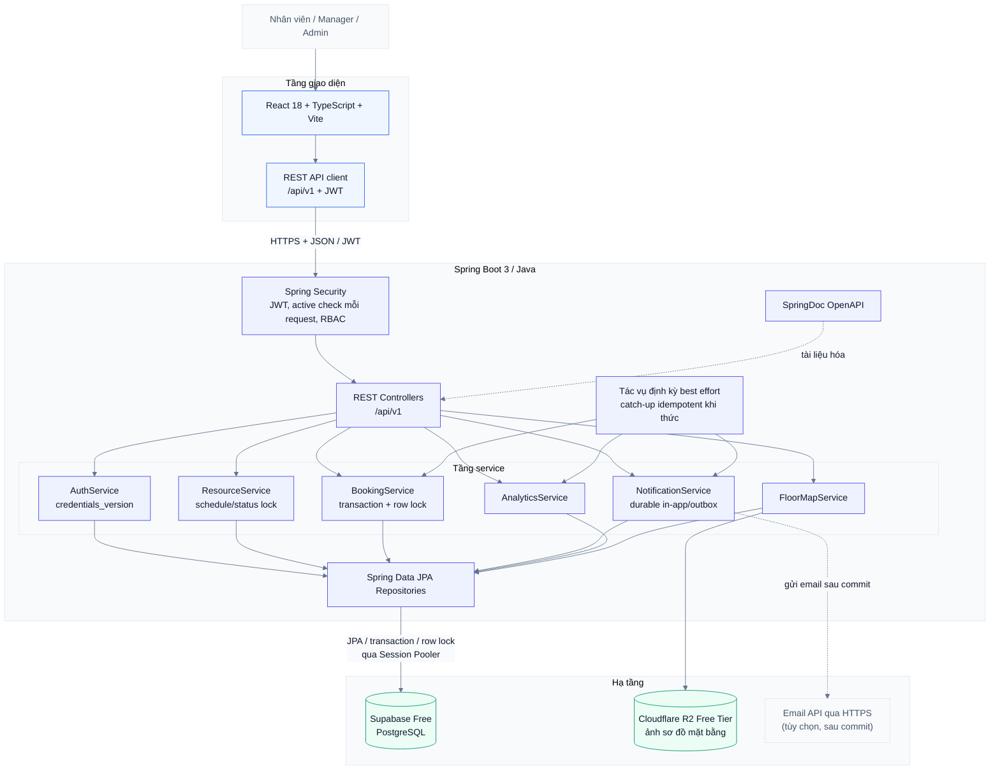
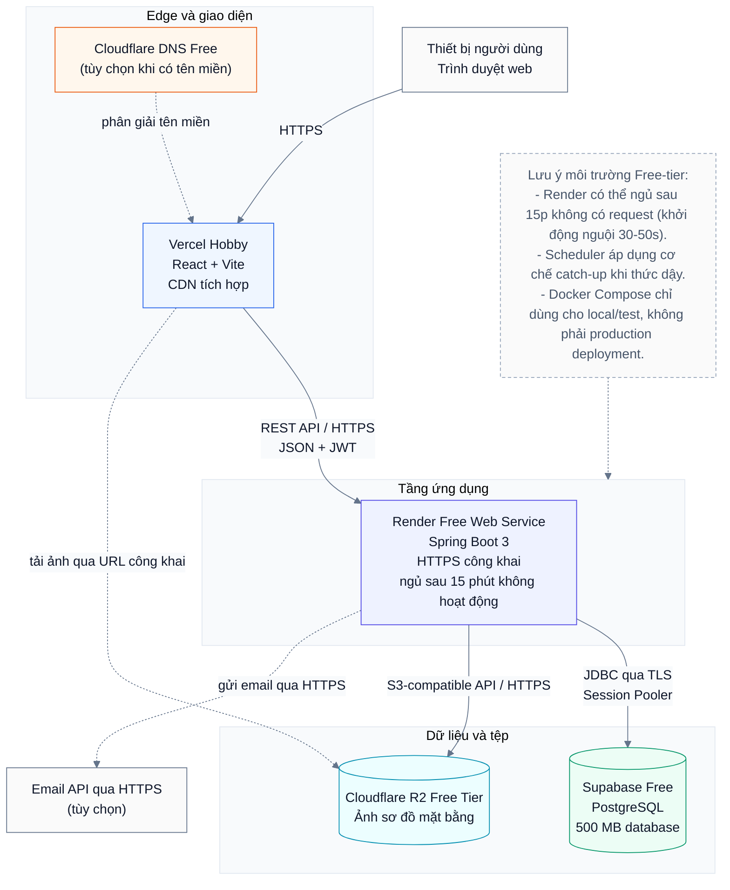

# Kiến trúc Hệ thống (System Architecture)

Tài liệu đặc tả kiến trúc kỹ thuật tổng quan, mô hình thành phần, và sơ đồ triển khai của dự án **Alloca**.

---

## 1. Sơ đồ Thiết kế Hệ thống (System Design)

Alloca được thiết kế theo kiến trúc phân tầng rõ ràng (N-Tier / Hexagonal Architecture):
- **Tầng Giao diện (Client)**: Ứng dụng Single Page Application (SPA) xây dựng trên React 18, TypeScript và Vite; giao tiếp qua REST API chuẩn hóa kèm JWT Bearer Token.
- **Tầng Ứng dụng (Backend)**: Spring Boot 3 chạy trên nền Java 17/21. Gồm các lớp:
  - `Security Filter`: Xác thực JWT, kiểm tra `is_active` tức thời và thẩm định RBAC.
  - `REST Controllers`: Xử lý HTTP request, mapping DTO theo OpenAPI spec.
  - `Domain & Application Services`: Chứa toàn bộ nghiệp vụ (Booking engine, Resource lifecycle, Analytics, Notification outbox).
  - `Spring Data JPA`: Quản lý truy xuất dữ liệu với cơ chế khóa bi quan (Pessimistic Locking).
  - `Spring Scheduler`: Tác vụ nền định kỳ và cơ chế tự động quét bù (Catch-up) khi backend khởi động lại.
- **Tầng Hạ tầng (Infrastructure)**: Supabase PostgreSQL (lưu trữ dữ liệu quan hệ), Cloudflare R2 (lưu ảnh sơ đồ mặt bằng), và Email API ngoài (tùy chọn).



---

## 2. Sơ đồ Triển khai (Deployment Architecture)

Mô hình triển khai Alloca hướng tới mục tiêu **vận hành demo với chi phí 0 đồng** tận dụng các dịch vụ Cloud Free Tier phổ biến:



---

## 3. Thành phần và Cấu trúc Mã nguồn (Package Structure)

Dự án áp dụng kiến trúc **Hexagonal / Clean Architecture** với cấu trúc module đề xuất:

```
com.alloca
├── domain                    <-- Core Domain Model (Java thuần, KHÔNG phụ thuộc Spring/JPA)
│   ├── booking               <-- Booking Entity, BookingStatus, TimeInterval VO
│   ├── resource              <-- Resource Entity, ResourceStatus, OperatingSchedule VO
│   ├── user                  <-- User Entity, Role, CredentialsVersion
│   ├── notification          <-- Notification Entity, NotificationType
│   └── alert                 <-- Alert Entity, AlertStatus, Episode
├── application               <-- Use Cases & Application Ports
│   ├── booking               <-- CreateBookingUseCase, CancelBookingUseCase
│   ├── resource              <-- ManageResourceUseCase, CheckAvailabilityUseCase
│   ├── auth                  <-- LoginUseCase, RefreshTokenUseCase
│   └── ports                 <-- In/Out Interfaces (Repositories, NotificationSender)
├── infrastructure            <-- Adapters & Framework Details
│   ├── persistence           <-- Spring Data JPA Entities & Repositories (PostgreSQL)
│   ├── security              <-- JwtTokenProvider, SecurityFilterChain, CurrentUserContext
│   ├── storage               <-- Cloudflare R2 S3 Client Adapter
│   ├── scheduler             <-- Spring Task Scheduler (Catch-up Jobs)
│   └── email                 <-- HTTPS Email API Client
└── web                       <-- HTTP Presentation Layer
    ├── controllers           <-- REST Controllers (@RestController)
    ├── dto                   <-- Request/Response DTOs & Validation Annotations
    └── exceptions            <-- GlobalExceptionHandler & ErrorResponse (RFC 7807)
```
