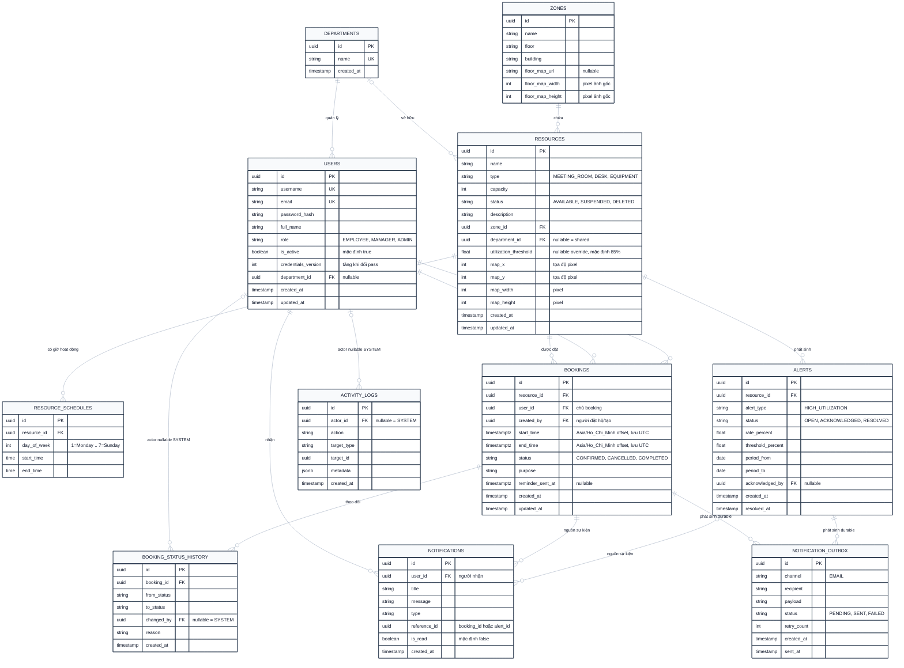

# Thiết kế Cơ sở Dữ liệu (Database Design & ERD)

Tài liệu đặc tả chi tiết mô hình dữ liệu quan hệ của hệ thống **Alloca Phase 1**, vận hành trên nền **PostgreSQL 15+ (Supabase)**.

---

## 1. Sơ đồ Thực thể Quan hệ (Entity Relationship Diagram - ERD)

---

## 2. Quy ước Thiết kế & Best Practices

1. **Khóa chính (Primary Keys)**:
   - Toàn bộ các bảng sử dụng kiểu dữ liệu `UUID` (khuyến nghị **UUIDv7** để đảm bảo tính tuần tự theo thời gian và hiệu năng B-Tree Index vượt trội so với UUIDv4 ngẫu nhiên).
2. **Thời gian & Múi giờ**:
   - Các trường mốc thời gian đặt chỗ (`start_time`, `end_time`) sử dụng kiểu `TIMESTAMPTZ` (lưu trữ UTC, có thông tin múi giờ khi deserialize).
   - Múi giờ nghiệp vụ chuẩn là `Asia/Ho_Chi_Minh` (UTC+7).
3. **Cơ chế Khóa & Chỉ mục (Indexes)**:
   - Bảng `bookings`:
     - Bắt buộc tạo Composite Index trên `(resource_id, status, start_time, end_time)` để tối ưu hóa truy vấn kiểm tra giao khoảng thời gian (`start < existing.end AND end > existing.start`).
   - Bảng `users`:
     - Unique Index trên `username` và `email`.
     - Index trên `(id, is_active, credentials_version)` để tối ưu hóa kiểm tra token mỗi request.
4. **Bảo toàn Dữ liệu & Xóa mềm**:
   - `RESOURCES`: Xóa mềm bằng cờ `status = 'DELETED'`. Tuyệt đối không chạy lệnh `DELETE FROM resources` để bảo toàn lịch sử đặt chỗ và khóa ngoại.
   - `USERS`: Vô hiệu hóa bằng `is_active = false`. Không xóa vật lý tài khoản đã từng tạo booking hoặc xuất hiện trong audit log.
