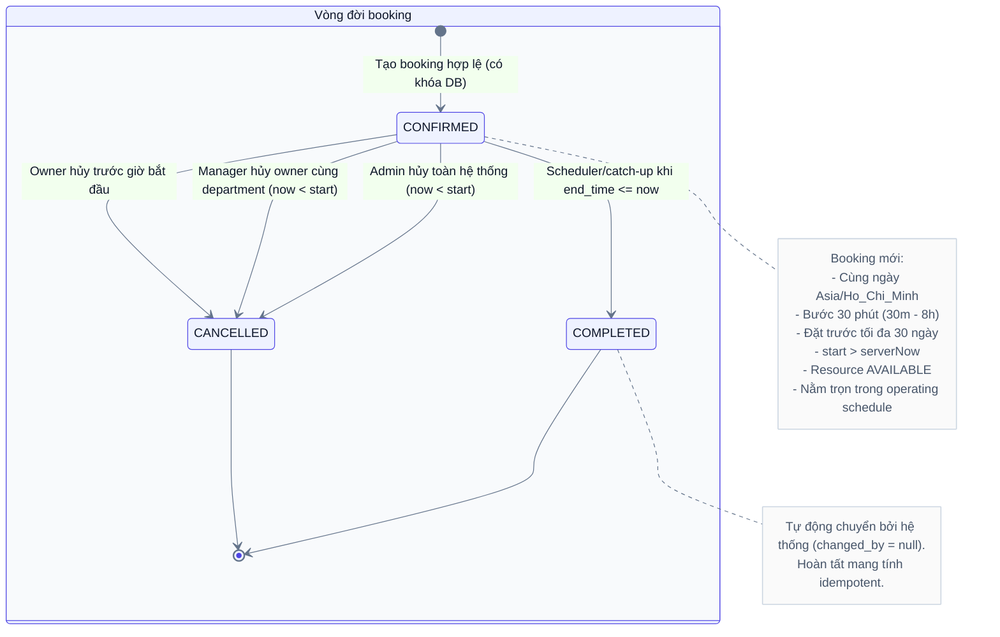
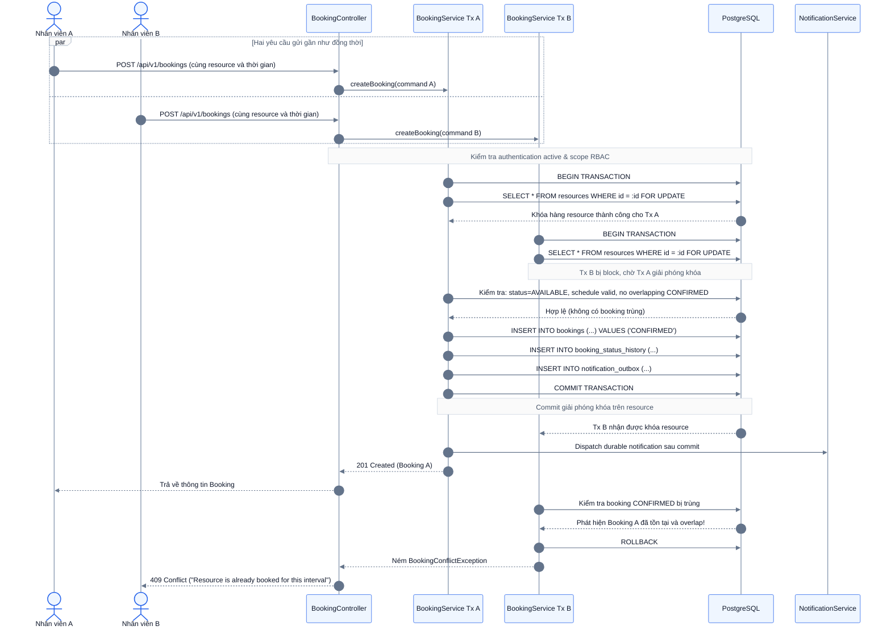
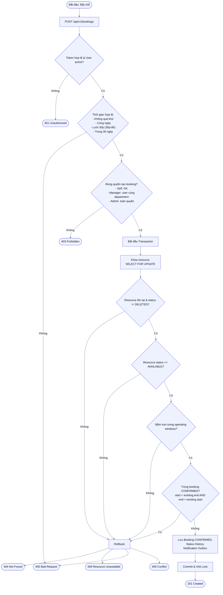

# Domain Spec: Booking & Time Engine

Tài liệu đặc tả chi tiết miền nghiệp vụ **Booking và Thời gian (Booking & Time Engine)** cho Alloca Phase 1.  
Tài liệu này là **Single Source of Truth** cho việc thiết kế Domain Model, Service Layer, Database Lock, và Unit/Integration Test của module Booking.

---

## 1. Quy tắc nghiệp vụ (Business Rules)

### BR-TIME-01 — Đã chốt (Locked Rules)
- **Timezone nghiệp vụ**: `Asia/Ho_Chi_Minh` (UTC+7). Mọi timestamp gửi lên API phải có offset rõ ràng và response trả về chuẩn hóa UTC (ISO-8601 `Z`).
- **Lưới thời gian (Slot Grid)**: Bắt đầu (`start_time`) và kết thúc (`end_time`) phải chia hết cho bước **30 phút** (phút chỉ có thể là `:00` hoặc `:30`, giây và micro giây phải bằng `0`).
- **Thời lượng booking**: Tối thiểu **30 phút**, tối đa **8 giờ** (480 phút).
- **Phạm vi ngày**: Booking **không được kéo dài qua ngày địa phương** (`start_time` và `end_time` phải cùng một ngày theo giờ `Asia/Ho_Chi_Minh`).
- **Khoảng thời gian đặt trước (Horizon)**: Cho phép đặt tối đa **30 ngày** tính từ thời điểm hiện tại của server (`serverNow <= start <= serverNow + 30 days`).
- **Không đặt trong quá khứ**: `start_time > serverNow` (kiểm tra trên đồng hồ server, không tin đồng hồ client).
- **Điều kiện hợp lệ**:
  - Toàn bộ khoảng booking `[start, end)` phải nằm trọn trong các khung giờ hoạt động (`operating_windows`) của resource.
  - Resource phải ở trạng thái `AVAILABLE`.
  - Không trùng với bất kỳ booking nào đang ở trạng thái `CONFIRMED`.
- **Khoảng nửa mở `[start, end)`**:
  - Hai booking bị coi là trùng/giao nhau khi: `start < existing.end AND end > existing.start`.
  - Hai booking tiếp giáp nhau (ví dụ: Booking 1 kết thúc lúc 10:00, Booking 2 bắt đầu lúc 10:00) được **phép** và không bị coi là xung đột.

### BR-TIME-02 — Mặc định triển khai (Implementation Defaults)
- **Kiểm tra tức thời (Strict Containment)**:
  - Khung giờ hoạt động theo tuần (`operating_windows`): các window trong cùng một ngày không overlap, `start < end`. Các window tiếp giáp nhau được hợp nhất để kiểm tra booking có nằm trọn trong đó hay không.
  - Ngày không có window tức là đóng cửa. Phase 1 không có lịch nghỉ lễ riêng (holiday calendar).
- **Lưới 30 phút độc lập**: Khung giờ hoạt động có thể bắt đầu ở phút lẻ (ví dụ 08:15 - 17:45), nhưng booking vẫn bắt buộc phải snap theo lưới 30 phút (ví dụ 08:30 - 17:30) nằm trọn trong đó.
- **Tính toán khả dụng (Availability)**:
  - API kiểm tra slot trống chỉ trả về các khoảng còn đặt được tính từ hiện tại (`> now`), loại bỏ các slot quá khứ.
  - Không có cơ chế giữ chỗ tạm (soft-lock/cart). Việc xem slot trống không cam kết giữ chỗ; khi gọi `POST /api/v1/bookings` hệ thống luôn khóa dòng và kiểm tra lại trên dữ liệu thật.
- **Bất biến (Immutability)**:
  - Phase 1 **không hỗ trợ sửa thời gian hoặc đổi resource** của booking đã tạo (`UPDATE /bookings/{id}` bị cấm).
  - Người dùng phải **HỦY (Cancel)** booking cũ và **TẠO MỚI (Create)** booking mới theo đúng quy trình.
- **Hủy booking**:
  - Chỉ được hủy khi trạng thái còn `CONFIRMED` và `now < start_time` (chưa đến giờ bắt đầu).
  - Khi booking đã đến giờ bắt đầu hoặc đang diễn ra (`now >= start_time`), không ai (kể cả Admin) được hủy qua flow thông thường trong Phase 1.

---

## 2. Sơ đồ trạng thái Booking (State Machine)

Booking tuân theo vòng đời trạng thái nghiêm ngặt, xử lý chuyển trạng thái đơn hướng:

---

## 3. Kiểm soát tương tranh & Cơ chế khóa (Concurrency Control)

Để tránh tình trạng đặt trùng phòng (double-booking) khi có nhiều request đồng thời, hệ thống sử dụng **Pessimistic Locking (`SELECT ... FOR UPDATE`)** trên dòng `Resource`:

---

## 4. Luồng xử lý chi tiết (Activity Flow)

---

## 5. API Endpoints liên quan

- `POST /api/v1/bookings` — Tạo booking mới.
- `GET /api/v1/bookings` — Lấy danh sách booking theo phân quyền (Employee: của mình; Manager: của department; Admin: all).
- `GET /api/v1/bookings/{id}` — Lấy chi tiết booking.
- `DELETE /api/v1/bookings/{id}` — Hủy booking (`CONFIRMED` và `now < start_time`).
- `GET /api/v1/resources/{resourceId}/availability` — Kiểm tra các khoảng thời gian trống theo ngày.

---

## 6. Tiêu chí kiểm thử nghiệm thu (Acceptance Test Checklist)

- [ ] **TC-BOOK-01**: Tạo booking với phút lẻ (ví dụ 09:15) trả về `400 Bad Request`.
- [ ] **TC-BOOK-02**: Tạo booking dưới 30 phút hoặc trên 8 giờ trả về `400 Bad Request`.
- [ ] **TC-BOOK-03**: Tạo booking qua đêm (23:00 hôm nay đến 01:00 hôm sau) trả về `400 Bad Request`.
- [ ] **TC-BOOK-04**: Tạo booking với `start_time` trong quá khứ trả về `400 Bad Request`.
- [ ] **TC-BOOK-05**: Tạo booking vượt quá 30 ngày tới trả về `400 Bad Request`.
- [ ] **TC-BOOK-06**: Hai booking tiếp giáp nhau (09:00 - 10:00 và 10:00 - 11:00) đều thành công `201 Created`.
- [ ] **TC-BOOK-07**: Hai booking giao nhau 1 phút (09:00 - 10:00 và 09:30 - 10:30) booking sau bị `409 Conflict`.
- [ ] **TC-BOOK-08 (Concurrency)**: Chạy 10 luồng song song đặt cùng 1 slot trên 1 resource, chỉ duy nhất 1 luồng trả về `201`, 9 luồng còn lại trả về `409 Conflict`.
- [ ] **TC-BOOK-09**: Hủy booking sau khi đã bắt đầu (`now >= start`) trả về `400/409 Error`.
- [ ] **TC-BOOK-10**: Scheduler tự động đổi booking sang `COMPLETED` khi `end_time <= now`.
