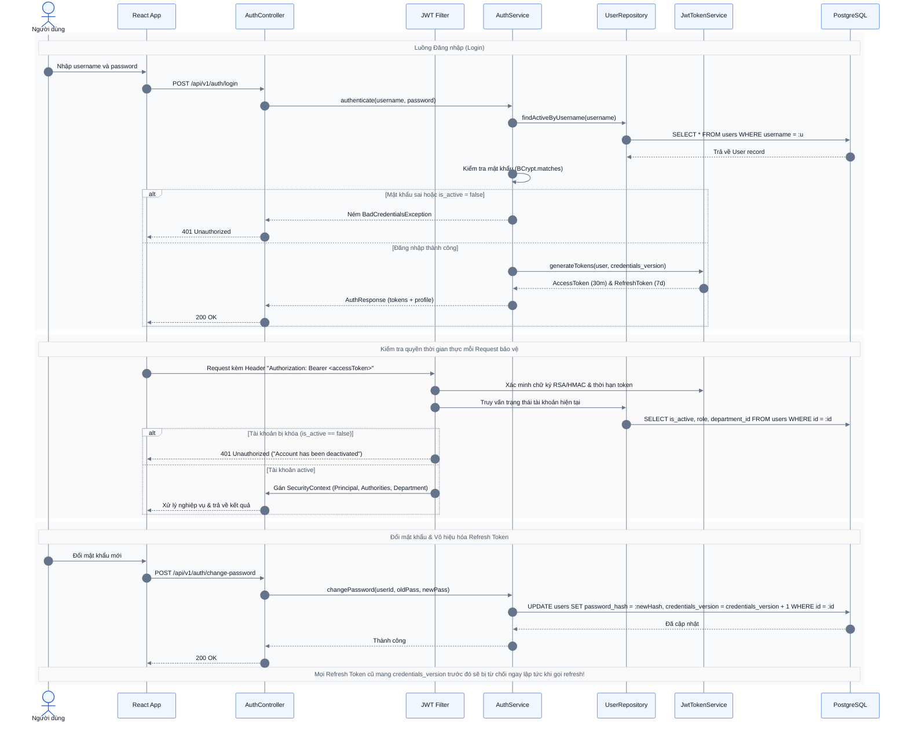

# Domain Spec: RBAC, Scope & Account Security

Tài liệu đặc tả chi tiết miền nghiệp vụ **Phân quyền (RBAC), Phạm vi dữ liệu (Scope) và Bảo mật tài khoản (Account Security)** cho Alloca Phase 1.  
Tài liệu này là **Single Source of Truth** cho việc thiết kế JWT Filter, Security Context, User Repository, Authorization Interceptor và Audit Log.

---

## 1. Quy tắc nghiệp vụ (Business Rules)

### BR-SCOPE-01 — Đã chốt (Locked Rules)
- **Hệ thống Vai trò (Roles)**:
  - `EMPLOYEE`: Chỉ được xem resource/availability, tạo/xem/hủy booking của **chính mình**, xem notification và lịch sử cá nhân.
  - `MANAGER`: Có toàn bộ quyền của Employee; ngoài ra được phép **tạo/xem/hủy booking của các nhân viên thuộc cùng Department** với mình; xem báo cáo và nhận alert của các Resource do Department mình sở hữu.
  - `ADMIN`: Toàn quyền thao tác trên toàn hệ thống (User, Department, Resource, Floor Map, System Settings, Booking, Reports).
- **Nguyên tắc xác định Booking Scope**:
  - Quyền hạn truy cập hoặc hủy booking **luôn dựa vào Department của CHỦ BOOKING (`user_id`)**, **KHÔNG** dựa vào người tạo hộ (`created_by`) và **KHÔNG** dựa vào Department sở hữu Resource.
  - Ví dụ: Manager phòng Sales chỉ được quản lý booking mà chủ booking là nhân viên phòng Sales (dù đặt phòng họp của phòng IT hay phòng họp Shared).
- **Phân loại Resource & Quyền đặt chỗ**:
  - Resource có thể thuộc sở hữu phòng ban hoặc dùng chung (`department_id = null`).
  - Sở hữu phòng ban của Resource **không hạn chế quyền đặt chỗ** của nhân viên phòng ban khác (ai là tài khoản active cũng đặt được nếu resource `AVAILABLE`).
  - Sở hữu phòng ban của Resource chỉ quyết định **phạm vi định tuyến cảnh báo (Alert Routing)**:
    - Alert của resource shared: gửi tới toàn bộ **Admin active**.
    - Alert của resource thuộc department: gửi tới toàn bộ **Manager active** phụ trách department đó.

### BR-SCOPE-02 — Mặc định triển khai (Implementation Defaults)
- **Quyền theo thời gian thực (Real-time Scope)**:
  - Phân quyền lấy theo Role và Department **hiện tại** của User trong cơ sở dữ liệu. Lịch sử booking không snapshot department trong MVP. Khi nhân viên chuyển phòng ban, phạm vi truy cập của Manager cũ/mới sẽ thay đổi theo phòng ban mới; việc chuyển phòng ban được ghi nhận trong audit log.
  - Việc chuyển department hoặc disable user **không tự ý hủy các booking** đã xác nhận trước đó.
  - Đặt hộ: Người được đặt hộ phải là tài khoản đang `is_active = true`. Người đặt hộ không có thêm quyền đọc booking sau khi mất department scope chỉ vì từng đặt hộ.
  - Manager không được gán Department nào sẽ không có quyền thao tác trên booking của người khác (chỉ còn quyền tự phục vụ của Employee).

### BR-AUTH-01 — Đã chốt (Locked Rules)
- **Vòng đời JWT Token**:
  - **Access Token**: Thời hạn **30 phút**. Mang thông tin `userId`, `role`, `departmentId`.
  - **Refresh Token**: Thời hạn **7 ngày**.
- **Kiểm tra trạng thái tài khoản thời gian thực (Active Enforcement)**:
  - Mọi request bảo vệ đều phải kiểm tra trạng thái `is_active = true` trong database. Nếu tài khoản bị vô hiệu hóa (deactivated), request bị từ chối ngay lập tức với mã `401 Unauthorized` dù Access Token còn hạn.
- **Vô hiệu hóa phiên khi đổi mật khẩu**:
  - Việc đổi hoặc reset mật khẩu phải **vô hiệu hóa ngay lập tức toàn bộ Refresh Token** đã phát hành trước đó.

### BR-AUTH-02 — Mặc định triển khai (Implementation Defaults)
- **Cơ chế Monotonic `credentials_version`**:
  - Trong bảng `users` lưu một số nguyên `credentials_version` (khởi tạo = 1). Claim này được nhúng vào Refresh Token khi đăng nhập.
  - Khi người dùng đổi mật khẩu hoặc bị vô hiệu hóa, `credentials_version` được tăng lên 1 trong cùng transaction lưu mật khẩu mới.
  - Endpoint `POST /api/v1/auth/refresh` yêu cầu: chữ ký token hợp lệ, chưa hết hạn, đúng loại refresh, tài khoản `is_active = true`, và `token.credentials_version == user.credentials_version`. Bất kỳ sự sai lệch nào đều khiến request refresh bị từ chối `401 Unauthorized`.
- **Đăng xuất (Logout) Phase 1**: Phía client xóa token trong storage. Logout server-side toàn bộ các phiên active và xoay vòng refresh token (rotation) là tính năng ngoài phạm vi Phase 1.

---

## 2. Sơ đồ ma trận phân quyền (RBAC Overview)

```mermaid
%%{init: {"theme":"base","themeVariables":{"background":"#F8FAFC","primaryColor":"#EEF2FF","primaryBorderColor":"#4F46E5","primaryTextColor":"#0F172A","lineColor":"#64748B","textColor":"#0F172A","clusterBkg":"#F8FAFC","clusterBorder":"#CBD5E1","edgeLabelBackground":"#F8FAFC"},"flowchart":{"curve":"basis","htmlLabels":true}}}%%
flowchart LR
    employee@{ shape: person, label: "Nhân viên (Employee)" }
    manager@{ shape: person, label: "Quản lý (Manager)" }
    admin@{ shape: person, label: "Quản trị viên (Admin)" }

    subgraph employeeScope["Phạm vi Cá nhân"]
        e1["Xem Resource & Slot Availability"]
        e2["Tạo booking cho chính mình"]
        e3["Hủy booking của mình (now < start)"]
        e4["Xem danh sách & thông báo cá nhân"]
        e5["Đặt chỗ trực tiếp từ Floor Map"]
    end

    subgraph managerScope["Phạm vi Department của Chủ Booking"]
        m1["Tạo/xem/hủy booking cho nhân viên cùng Department"]
        m2["Xem báo cáo sử dụng resource do Department sở hữu"]
        m3["Nhận cảnh báo sử dụng (Alert) của Resource thuộc Department"]
    end

    subgraph adminScope["Phạm vi Toàn hệ thống"]
        a1["Quản lý Account, Role, Department"]
        a2["Quản lý Resource, Lịch hoạt động, Floor Map"]
        a3["Cấu hình Ngưỡng cảnh báo & Thời gian nhắc lịch"]
        a4["Xem toàn bộ Dashboard, Báo cáo & Lịch sử"]
        a5["Thao tác trên mọi booking trước giờ bắt đầu"]
        a6["Nhận cảnh báo sử dụng của Resource Shared"]
    end

    scopeNote["Ghi chú Scope: Dựa vào Department hiện tại của OWNER (chủ booking),<br/>không dựa vào người tạo hộ (created_by) hay department sở hữu resource."]
    manager -. "kế thừa quyền" .-> employee
    admin -. "kế thừa quyền" .-> manager
    employee --> e1 & e2 & e3 & e4 & e5
    manager --> m1 & m2 & m3
    admin --> a1 & a2 & a3 & a4 & a5 & a6
    scopeNote -.-> m1

    classDef employeeRole fill:#EFF6FF,stroke:#2563EB,stroke-width:1.5px,color:#0F172A;
    classDef managerRole fill:#EEF2FF,stroke:#4F46E5,stroke-width:1.5px,color:#0F172A;
    classDef adminRole fill:#F5F3FF,stroke:#7C3AED,stroke-width:1.5px,color:#0F172A;
    class employee employeeRole;
    class manager managerRole;
    class admin adminRole;
```

---

## 3. Luồng Xác thực & Bảo mật (Authentication Sequence)



---

## 4. API Endpoints liên quan

- `POST /api/v1/auth/login` — Đăng nhập bằng username/password, nhận access & refresh token.
- `POST /api/v1/auth/refresh` — Đổi refresh token lấy access token mới.
- `POST /api/v1/auth/change-password` — Đổi mật khẩu (tự động tăng `credentials_version`).
- `GET /api/v1/auth/me` — Lấy thông tin user hiện tại kèm vai trò và phòng ban.
- `GET /api/v1/users` — Quản trị danh sách người dùng (Admin only).
- `POST /api/v1/users` — Tạo người dùng mới (Admin only).
- `PATCH /api/v1/users/{id}/status` — Kích hoạt hoặc vô hiệu hóa (`is_active = false`) người dùng.

---

## 5. Tiêu chí kiểm thử nghiệm thu (Acceptance Test Checklist)

- [ ] **TC-SEC-01**: Đăng nhập bằng tài khoản `is_active = false` trả về `401 Unauthorized`.
- [ ] **TC-SEC-02**: Gọi API bảo vệ bằng token hợp lệ nhưng sau khi Admin vô hiệu hóa tài khoản (`is_active = false`) thì request ngay lập tức trả về `401 Unauthorized`.
- [ ] **TC-SEC-03**: Gọi `POST /api/v1/auth/refresh` với refresh token cũ sau khi người dùng vừa đổi mật khẩu trả về `401 Unauthorized` (do lệch `credentials_version`).
- [ ] **TC-SEC-04**: Employee cố gắng xem hoặc hủy booking của nhân viên khác trả về `403 Forbidden`.
- [ ] **TC-SEC-05**: Manager cố gắng xem hoặc hủy booking của nhân viên thuộc phòng ban khác trả về `403 Forbidden`.
- [ ] **TC-SEC-06**: Manager tạo hoặc hủy booking cho nhân viên cùng phòng ban thành công `200/201`.
- [ ] **TC-SEC-07**: Admin có thể xem và hủy bất kỳ booking nào trên toàn hệ thống trước giờ bắt đầu.
