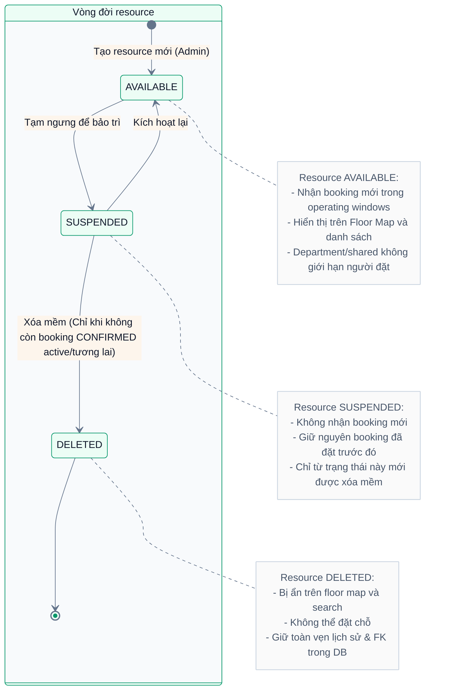

# Domain Spec: Resources & Operating Schedules

Tài liệu đặc tả chi tiết miền nghiệp vụ **Tài nguyên và Lịch hoạt động (Resources & Operating Schedules)** cho Alloca Phase 1.  
Tài liệu này là **Single Source of Truth** cho việc thiết kế Resource Management, Schedule Engine, Soft-delete và Concurrency Lock trên Resource.

---

## 1. Quy tắc nghiệp vụ (Business Rules)

### BR-RESOURCE-01 — Đã chốt (Locked Rules)
- **Vòng đời trạng thái Resource**:
  - `AVAILABLE`: Sẵn sàng tiếp nhận booking mới trong các khung giờ hoạt động.
  - `SUSPENDED`: Tạm dừng hoạt động (bảo trì/sửa chữa). Chặn toàn bộ booking mới, nhưng **vẫn giữ nguyên** các booking cũ đã đặt trước đó.
  - `DELETED`: Xóa mềm (soft-delete). Bị ẩn hoàn toàn đối với người dùng cuối trên Floor Map và danh sách tìm kiếm, nhưng vẫn lưu dữ liệu trong database để phục vụ báo cáo lịch sử và audit log.
- **Ràng buộc xóa mềm (Safe Deletion)**:
  - Chỉ cho phép chuyển sang `DELETED` khi resource đang ở trạng thái `SUSPENDED`. **Tuyệt đối không cho phép xóa trực tiếp từ `AVAILABLE`**.
  - Chỉ được xóa khi **không còn bất kỳ booking `CONFIRMED` nào chưa kết thúc** (`end_time > now`). Nếu còn dù chỉ 1 booking đang diễn ra hoặc trong tương lai, hệ thống phải từ chối xóa và trả về danh sách booking ngăn chặn.
- **Bảo vệ Booking khi sửa lịch hoạt động (Schedule Conflict Protection)**:
  - Khi Admin cập nhật `operating_schedules` (ví dụ rút ngắn giờ mở cửa hoặc đóng cửa một thứ trong tuần), nếu khung giờ mới làm bất kỳ booking `CONFIRMED` nào trong tương lai trở nên không hợp lệ (nằm ngoài lịch), hệ thống **bắt buộc phải chặn cập nhật** và trả về lỗi `409 Conflict` kèm danh sách các booking bị xung đột.
  - Hệ thống **không được tự ý hủy** booking của người dùng; Admin phải tự xử lý (liên hệ hủy hoặc đổi lịch) trước khi cập nhật lịch.

### BR-RESOURCE-02 — Mặc định triển khai (Implementation Defaults)
- **Bảo vệ booking đang diễn ra**: Khi kiểm tra điều kiện xóa hoặc sửa schedule, hệ thống bảo vệ cả booking đang diễn ra (`end > now`), không chỉ booking chưa bắt đầu (`start > now`).
- **Khóa tương tranh (Transactional Lock)**:
  - Mọi thao tác: (1) Tạo booking, (2) Thay đổi schedule, (3) Thay đổi trạng thái/Xóa resource đều phải **khóa dòng resource (`SELECT ... FOR UPDATE`)** trong transaction để tránh race condition kiểm tra trên dữ liệu cũ.
  - Không gửi email hay gọi API bên ngoài khi đang giữ lock database.
- **Phân loại sở hữu Resource**:
  - Resource có thể thuộc về một phòng ban (`department_id != null`) hoặc là tài nguyên dùng chung toàn công ty (`department_id = null` - shared resource).
  - Phòng ban sở hữu **chỉ dùng để xác định phạm vi nhận báo cáo / alert sử dụng**, **không tạo giới hạn ai được phép đặt**. Nhân viên phòng ban A vẫn được quyền đặt resource thuộc phòng ban B nếu resource đó đang `AVAILABLE`.
- **Soft-delete quan hệ**: Xóa mềm User là deactivate tài khoản. Xóa Department bị chặn nếu còn resource hoặc user tham chiếu.
- **Xóa Zone (ALC-31)**: bị chặn nếu còn resource **chưa bị xóa mềm** trong zone. Resource đã xóa mềm vẫn giữ `zone_id` để phục vụ lịch sử, nên zone được xóa mềm (`deleted_at`): ẩn khỏi danh sách, không thể gán cho resource mới, và được coi như không tồn tại (404).

---

## 2. Sơ đồ trạng thái Resource (State Machine)

---

## 3. Cấu trúc Lịch hoạt động (Operating Schedule Schema)

Một Resource có thể có nhiều khung giờ hoạt động trong tuần (`resource_schedules`):
- `day_of_week`: Thứ trong tuần (1 = Monday, 7 = Sunday).
- `start_time`: Thời gian mở cửa (LocalTime, ví dụ `08:00:00`).
- `end_time`: Thời gian đóng cửa (LocalTime, ví dụ `18:00:00`).
- **Quy tắc**: Trong cùng 1 ngày, các window không được giao nhau (`start < end`). Các window tiếp giáp nhau (ví dụ `08:00 - 12:00` và `12:00 - 17:00`) được hợp nhất khi kiểm tra điều kiện containment cho booking.
- Ngày không cấu hình khung giờ nào được coi là **Đóng cửa (Closed)**.

---

## 4. API Endpoints liên quan

- `GET /api/v1/resources` — Lấy danh sách resource (hỗ trợ filter theo zone, type, status, department).
- `GET /api/v1/resources/{id}` — Lấy chi tiết resource kèm lịch hoạt động và vị trí trên map.
- `POST /api/v1/resources` — Tạo resource mới (Admin only).
- `PATCH /api/v1/resources/{id}` — Cập nhật thông tin cơ bản / map position (Admin only).
- `PATCH /api/v1/resources/{id}/status` — Đổi trạng thái (`AVAILABLE` ↔ `SUSPENDED`).
- `DELETE /api/v1/resources/{id}` — Xóa mềm resource (yêu cầu đang `SUSPENDED` và không có booking `CONFIRMED` active).
- `PUT /api/v1/resources/{id}/schedules` — Cập nhật toàn bộ lịch hoạt động theo tuần (Admin only, có kiểm tra xung đột booking).

---

## 5. Tiêu chí kiểm thử nghiệm thu (Acceptance Test Checklist)

- [ ] **TC-RES-01**: Cố gắng xóa mềm resource đang ở trạng thái `AVAILABLE` trả về `400 Bad Request` ("Must be SUSPENDED before deletion").
- [ ] **TC-RES-02**: Xóa mềm resource đang `SUSPENDED` nhưng còn booking `CONFIRMED` trong tương lai trả về `409 Conflict` kèm danh sách ID booking xung đột.
- [ ] **TC-RES-03**: Xóa mềm resource đang `SUSPENDED` và không còn booking nào trả về `204 No Content`, resource chuyển sang `DELETED`.
- [ ] **TC-RES-04**: Resource ở trạng thái `DELETED` không xuất hiện trong `GET /api/v1/resources` của Employee/Manager.
- [ ] **TC-RES-05**: Cập nhật operating schedule làm 1 booking trong tương lai rơi ra ngoài giờ mở cửa trả về `409 Conflict` kèm danh sách booking bị ảnh hưởng.
- [ ] **TC-RES-06**: Cố gắng tạo booking mới vào resource đang `SUSPENDED` trả về `409 Resource Unavailable`.
- [ ] **TC-RES-07**: Khi cập nhật trạng thái resource, transaction sử dụng `SELECT ... FOR UPDATE` để chống race condition.
