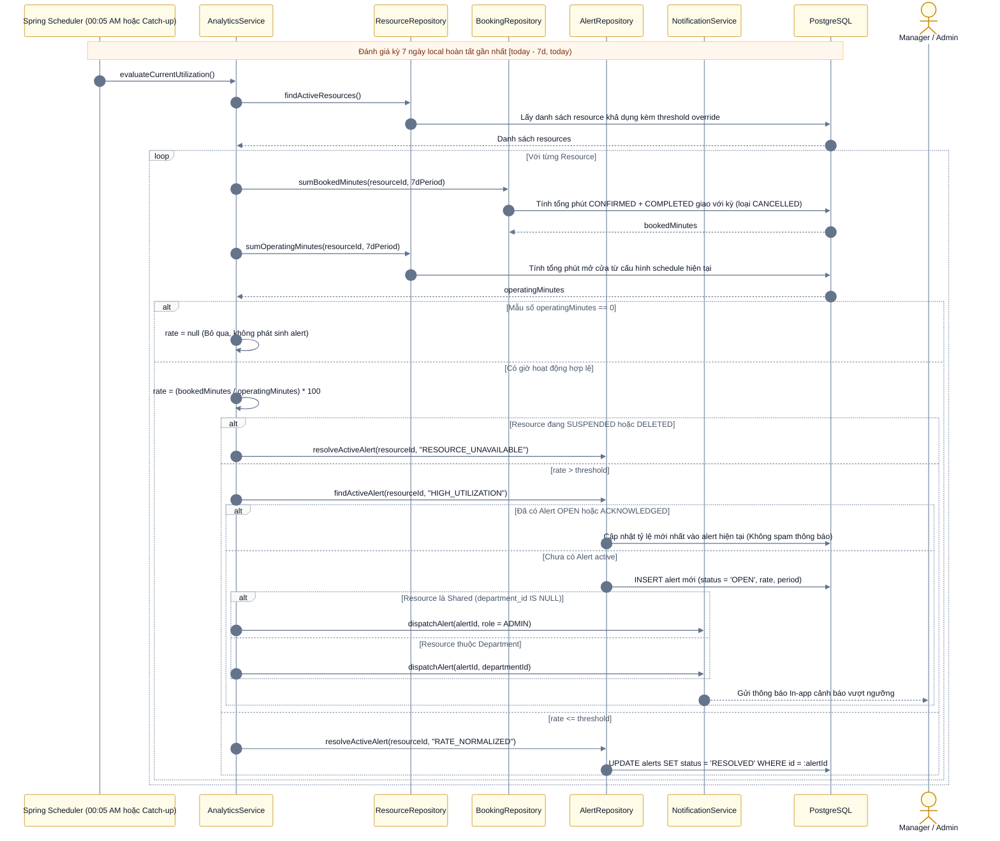

# Domain Spec: Booking Utilization & Alerts Engine

Tài liệu đặc tả chi tiết miền nghiệp vụ **Thống kê tỷ lệ đặt chỗ (Utilization) và Hệ thống Cảnh báo (Alerts Engine)** cho Alloca Phase 1.  
Tài liệu này là **Single Source of Truth** cho việc thiết kế Analytics Service, Utilization Calculation Formula, Daily Alert Evaluation Job, và Dashboard Reports.

---

## 1. Quy tắc nghiệp vụ (Business Rules)

### BR-STAT-01 — Đã chốt (Locked Rules)
- **Chu kỳ báo cáo**: Báo cáo theo Tuần hoặc Tháng; tính toán theo múi giờ địa phương `Asia/Ho_Chi_Minh`.
- **Thuật ngữ chuẩn trên UI/API**: **"Tỷ lệ thời gian đã đặt" (Booked Time Ratio / Booking Utilization)** — phản ánh thời gian tài nguyên được cam kết giữ chỗ, không chứng minh mức độ hiện diện/sử dụng thực tế (do Phase 1 không có cảm biến IoT/check-in).
- **Công thức tính toán**:
  $$\text{Utilization Rate (\%)} = \frac{\text{Tổng phút đã đặt (Booked Minutes)}}{\text{Tổng phút mở cửa hoạt động (Available Minutes)}} \times 100$$
  - **Tử số (Booked Minutes)**: Tổng thời gian của các booking ở trạng thái `CONFIRMED` và `COMPLETED` có giao với kỳ báo cáo (chỉ tính phần thời gian nằm gọn trong kỳ). **Loại bỏ hoàn toàn booking `CANCELLED`**. Việc hoàn thành booking không làm giảm tỷ lệ này.
  - **Mẫu số (Available Minutes)**: Tổng thời gian các khung giờ hoạt động (`operating_windows`) được cấu hình trong kỳ báo cáo.
- **Cơ chế Cảnh báo vượt ngưỡng (Alert Evaluation)**:
  - Job tự động chạy mỗi ngày, đánh giá dữ liệu của **7 ngày địa phương gần nhất đã hoàn tất** (Rolling 7 days).
  - Ngưỡng cảnh báo mặc định toàn hệ thống là **85%**; Admin có quyền cấu hình ngưỡng riêng (override) cho từng resource cụ thể.
  - Định tuyến thông báo cảnh báo tuân thủ theo **BR-SCOPE-01**:
    - Resource thuộc Department: Gửi thông báo tới toàn bộ **Manager active** của department sở hữu resource.
    - Resource Shared: Gửi thông báo tới toàn bộ **Admin active**.

### BR-STAT-02 — Mặc định triển khai (Implementation Defaults)
- **Quy ước ranh giới kỳ báo cáo**:
  - Kỳ Tuần: từ thứ Hai 00:00:00 đến thứ Hai tiếp theo 00:00:00 (khoảng nửa mở `[from, to)`).
  - Kỳ Tháng: từ ngày 1 đầu tháng 00:00:00 đến ngày 1 tháng kế tiếp 00:00:00.
  - Báo cáo cho kỳ hiện tại: Tính toán trên toàn bộ kỳ (bao gồm cả các booking tương lai đã được xác nhận và toàn bộ lịch hoạt động của kỳ đó).
- **Kỳ đánh giá Alert**:
  - `[00:00 hôm nay - 7 ngày, 00:00 hôm nay)` theo giờ `Asia/Ho_Chi_Minh`. Đây là 7 ngày trọn vẹn đã qua, **không tính phần ngày đang diễn ra**.
- **Điều kiện kích hoạt Alert**:
  - Chỉ kích hoạt khi `rate > threshold` (lớn hơn tuyệt đối; đạt đúng 85.0% với threshold 85% thì **không** phát alert). Ngưỡng hợp lệ từ 0 đến 100.
  - Nếu mẫu số bằng 0 (ví dụ resource đóng cửa cả tuần, không có giờ hoạt động): `rate = null` (N/A); không kích hoạt hoặc đóng alert dựa trên dữ liệu không xác định.
- **Tính toán mẫu số theo cấu hình hiện hành**:
  - Mẫu số tính dựa trên lịch tuần **hiện đang được cấu hình** của resource. Phase 1 không lưu snapshot lịch sử thay đổi lịch hoạt động. Tạm ngưng (`SUSPENDED`) không làm trừ giờ khỏi mẫu số.
- **Tránh spam & Vòng đời Alert (Alert Lifecycle & Deduplication)**:
  - Mỗi resource và mỗi loại alert chỉ tồn tại **tối đa 1 alert ở trạng thái active** (`OPEN` hoặc `ACKNOWLEDGED`).
  - Khi tỷ lệ vượt ngưỡng: Nếu chưa có alert active -> Tạo episode mới (`OPEN`) và gửi thông báo. Nếu đã có alert active -> Cập nhật số liệu tỷ lệ mới nhất vào kỳ đó, **không gửi lại thông báo spam**.
  - Khi tỷ lệ giảm xuống `<= threshold`: Tự động chuyển alert active sang trạng thái `RESOLVED`. Lần vượt ngưỡng kế tiếp sẽ tạo một episode mới.
  - Nếu resource bị chuyển sang `SUSPENDED` hoặc `DELETED`: Tự động resolve alert đang mở với lý do tài nguyên không còn khả dụng.
- **Báo cáo sử dụng phòng ban (Department Utilization Report)**:
  - Báo cáo cấp phòng ban tổng hợp dựa trên các Resource do **phòng ban đó sở hữu** (tính mọi booking trên các resource đó bất kể người đặt thuộc phòng ban nào). Không nhầm lẫn báo cáo này với danh sách booking của nhân viên trong phòng ban.

---

## 2. Sơ đồ luồng đánh giá Cảnh báo (Utilization Alert Flow)

---

## 3. API Endpoints liên quan

- `GET /api/v1/analytics/utilization` — Lấy báo cáo tỷ lệ sử dụng (Admin xem toàn hệ thống; Manager xem các resource của phòng ban).
- `GET /api/v1/analytics/booking-trends` — Biểu đồ xu hướng đặt chỗ theo ngày bắt đầu sử dụng và trạng thái.
- `GET /api/v1/alerts` — Lấy danh sách cảnh báo (Admin xem all, Manager xem cảnh báo của resource phòng ban mình).
- `PATCH /api/v1/alerts/{id}/acknowledge` — Xác nhận đã xem cảnh báo (`OPEN` ➔ `ACKNOWLEDGED`).
- `PATCH /api/v1/resources/{id}/threshold` — Admin thiết lập ngưỡng cảnh báo riêng cho một resource.

---

## 4. Tiêu chí kiểm thử nghiệm thu (Acceptance Test Checklist)

- [ ] **TC-STAT-01**: Booking bị hủy (`CANCELLED`) không được cộng vào tử số khi tính tỷ lệ thời gian đã đặt.
- [ ] **TC-STAT-02**: Booking `CONFIRMED` và `COMPLETED` giao một phần với kỳ báo cáo chỉ được tính phần số phút nằm trong kỳ.
- [ ] **TC-STAT-03**: Khi tổng thời gian mở cửa = 0, endpoint trả về `rate = null`, không văng lỗi chia cho 0 (`DivisionByZeroException`).
- [ ] **TC-STAT-04**: Với threshold = 85%, tỷ lệ tính ra đúng 85.0% **không** kích hoạt alert.
- [ ] **TC-STAT-05**: Khi tỷ lệ đạt 86% lần đầu tiên, hệ thống tạo 1 alert trạng thái `OPEN` và gửi đúng thông báo tới Manager/Admin.
- [ ] **TC-STAT-06**: Chạy lại job ngày hôm sau khi tỷ lệ vẫn là 88%, hệ thống cập nhật số liệu trên alert cũ, **không** tạo thêm alert thứ hai và **không** gửi thông báo lặp lại.
- [ ] **TC-STAT-07**: Khi tỷ lệ giảm xuống 70%, alert tự động chuyển sang `RESOLVED`.
- [ ] **TC-STAT-08**: Manager phòng ban A không được xem cảnh báo của resource thuộc phòng ban B (`403 Forbidden`).
